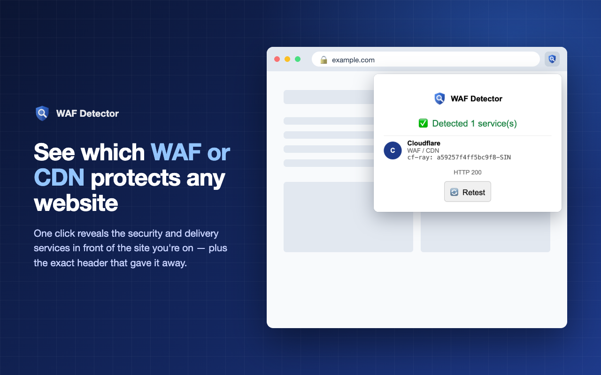

<p align="center">
  
</p>

<h1 align="center">WAF Detector</h1>

<p align="center">
  A Chrome extension that shows which web application firewall (WAF), CDN or edge service
  is in front of the website you're viewing.
</p>

<p align="center">
  
</p>

## Features

- **One click:** open the popup on any site to see every service it recognizes, plus the exact
  response header that identified it.
- **24 services:** see the [list](#supported-services) below.
- **Privacy first:**
  - Site access is requested one site at a time.
  - Cookies are never sent with the check request.
  - Nothing is collected, and there are no external servers.
- **Honest results:** CDNs are labelled "WAF not confirmed". A missing signature is reported as
  such, not as "unprotected".
- **Copy report:** copy the URL, time, HTTP status and every match as plain text for a pentest
  report.
- **Readable at a glance:** each service shows its brand color, and the popup follows your
  system's light or dark theme.

## Install

**From source** (until the Chrome Web Store listing is live):

1. Clone or download this repository.
2. Open `chrome://extensions` and turn on **Developer mode**.
3. Click **Load unpacked** and select the repository folder.

## How it works

1. The popup reads the active tab's URL. This uses the `activeTab` permission.
2. If the extension doesn't have access to that site yet, it shows **Allow & check**.
   Chrome then asks for access to that one host. The permission is optional, so it is requested
   only when you click.
3. The background service worker sends a `HEAD` request without cookies to the page. It falls
   back to `GET` if the site rejects `HEAD`, and gives up after a 10-second timeout.
4. The response headers are matched against [`wafSignatures.js`](wafSignatures.js) locally.

**Limitations:**
- Detection relies on response headers, and some WAFs strip or hide them.
- `Set-Cookie` can't be read with `fetch()`, so cookie-based signatures (e.g. `incap_ses_*`) are
  not used.

## Supported services

| WAF / security | CDN / edge (WAF not confirmed) |
|---|---|
| Cloudflare, Imperva (Incapsula), Akamai, AWS WAF, Sucuri, F5 BIG-IP, Citrix NetScaler, Fastly Next-Gen WAF (Signal Sciences), Radware AppWall, Wallarm, Reblaze, ModSecurity, DDoS-Guard, Qrator, ArvanCloud | AWS CloudFront, Azure Front Door, Google Cloud Load Balancer, Fastly, Edgio / Edgecast, Vercel, Netlify, BunnyCDN, KeyCDN |

## Adding a signature

Add an entry to `wafSignatures.js`. `match` receives a `Map` of lowercased header name to
lowercased value. It returns the name of the header that matched, or `null`.

```js
{
  name: "Example WAF",
  category: "WAF",
  color: "#1A73E8", // brand color for the badge and card accent
  match: (h) => first(has(h, "x-example-id"), contains(h, "server", "examplewaf"))
}
```

Pull requests are welcome. Please include a public site where the signature can be verified.

## Build for the Chrome Web Store

```sh
./build.sh   # → dist/waf-detector-<version>.zip
```

Only the files the extension needs are included. Store listing assets and copy live in
[`store/`](store/), and the privacy policy is in [`docs/`](docs/privacy-policy.html), which is
served with GitHub Pages.

## Privacy

WAF Detector does not collect, store or share any data. See the
[privacy policy](https://zildjiean.github.io/WhatWAF/privacy-policy.html).

## License

[MIT](LICENSE)

The bundled fonts, Instrument Sans and JetBrains Mono, are licensed under the SIL Open Font License
1.1 (see [`fonts/`](fonts/)).

All product names and trademarks are the property of their respective owners. This project is not
affiliated with or endorsed by any of them.
